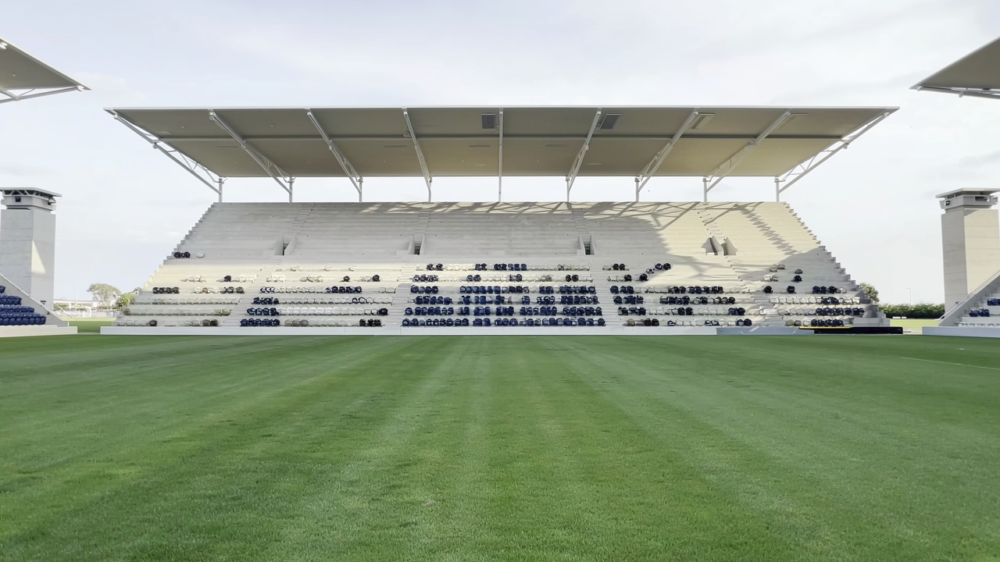
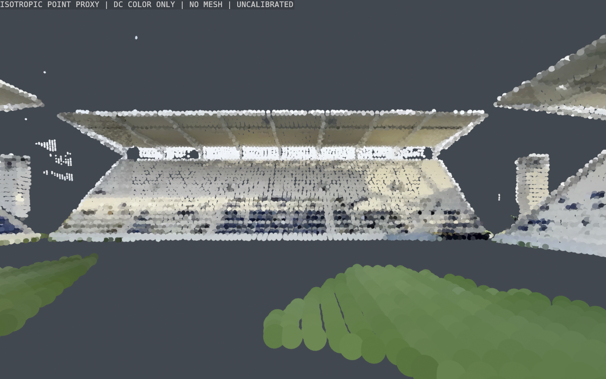

# Chisel stadium trial — 18 October 2026

## Decision

**Do not replace the app stadium.** Studio produced attractive images, but its
beta “placeholder splat” has large gaps, incomplete roof coverage and detached
patches of grass. A successful generation is not native asset admission.

`ReplayXI/Resources/Environment/ReplayXIStadium.usdz` remains unchanged:
`78adb0f5fd3b240e65b3618cfcab045429827c1a94572648a5360b4aa1017c9e`.
Playback remains local. No account code, API key, remote loading or new runtime
dependency was added to Replay XI.

## Trial

- Used the signed-in **Studio only**, in the saved scene
  **Replay XI — Stadium Trial 179**. No API authentication.
- Uploaded original, locally authored Blender architecture, not match footage,
  player likenesses or another stadium asset.
- Original seed: 20,432 triangles, four materials, five exported cameras,
  metre-scale/Y-up and a clear 72 × 112 m opening around the 68 × 105 m pitch.
- Chisel's mesh import did not retain the GLB cameras. Cameras were set in
  Studio. Automatic upscaling was disabled.
- The first single-camera render returned no reconstructed depth. One retry
  did not solve that. A separate six-view render, using translated camera
  positions, enabled one splat preview. No video, upscales, paid meshing or
  further generation was requested after its poor quality was visible.
- Studio warned that its current splat system is a **placeholder**.
- The Studio usage ledger showed **6 credits spent**, all under
  `marble5 agent.llmTurn`, at the last check. The Chisel sidebar's older
  10,000-credit badge was stale; it was not used to measure spend. This is the
  observed ledger, not a guarantee against delayed billing.

Six-view camera settings, as entered in Studio (X/Y/Z; degrees; FOV 48):

| View | Position | Rotation |
| --- | --- | --- |
| North | 0, 1.7, 0 | 3.1, 0, 0 |
| East-north | 2, 1.7, -2 | 8, -60, 0 |
| East-south | 2, 1.7, 2 | 8, -120, 0 |
| South | 0, 1.7, 3 | 8, 180, 0 |
| West-south | -2, 1.7, 2 | 8, 120, 0 |
| West-north | -2, 1.7, -2 | 8, 60, 0 |

The north render below is a generated reference image, **not an app screenshot
or proof of a complete 3D stadium**.



## Local artifacts

Raw outputs stay outside app resources, in ignored staging:
`.replayxi-world-staging/Chisel179/Studio/Preview02/`.

| File | SHA-256 |
| --- | --- |
| `stadium.spz` | `923e12848630d68e659b53bbf49ad8db51c4d77b8b016e09c5d55014a51d9c48` |
| `stadium.ply` | `01e5b509aef637665f3c3ce16f25bc34dcd37be3ab611cf5dc9f166687f10279` |
| `reference-views.zip` | `2d7384e936693a9988c86fc06c19699bfcbc1073b334a7da1e432e5cffcc5030` |

The SPZ contains **857,250 Gaussian points**, version 3, SH degree 0. It is not
a triangle mesh or a RealityKit-ready USDZ. The reference ZIP contains six RGB
renders and their Studio depth/ID captures; it does not include a calibrated
reconstruction receipt. Do not treat its depth captures as measured pitch
geometry or confuse them with the splat's reconstructed depth.

SPZ → PLY conversion used [Niantic's official browser tool](https://nianticlabs.github.io/spz/),
which runs locally in WebAssembly. No second service upload was needed. PLY
conversion preserves points; it does not repair holes or create a mesh.

## Blender inspection and optimisation

`Scripts/blender/inspect_chisel_splat179.py` makes a hash-checked, bounded
**inspection copy**, not a replacement stadium. The full SPZ/PLY stay intact.
It filters opacity below 0.05, averages occupied voxels and uses native Cycles
points, with no sphere instancing or surface reconstruction.

- 857,250 source points → 760,993 after opacity filtering → **52,867** preview
  points. The saved inspection blend is about 1.1 MB.
- Zero mesh faces, zero edges, zero instances. Eight CPU threads, eight samples,
  two 1280 × 800 diagnostic renders.
- Infinite opacity logits are valid alpha endpoints, not corrupt geometry.
  The importer preserves alpha=1 and handles alpha=0 before filtering.
- SH DC colours are retained. The preview does **not** reproduce anisotropic
  covariance, rotation or Gaussian alpha compositing. Mean opacity is saved
  as a separate attribute, not used as a false claim of faithful rendering.
- Display-only `(X,Z,-Y)` rotation assumes source Y-down. Source units and
  pitch registration remain unverified. No metric calibration is inferred
  from the generated bounds.

The result below is deliberately labelled a point proxy. The missing coverage
was also visible in Studio's original splat viewer before this downsampling.



The full measured report is
[`Evidence179/chisel-point-inspection.json`](Evidence179/chisel-point-inspection.json).
Timing fields are local import/render observations, **not app performance**.

To reproduce into a new staging directory:

```sh
/Applications/Blender.app/Contents/MacOS/Blender \
  --factory-startup --background --python-exit-code 1 \
  --python Scripts/blender/inspect_chisel_splat179.py -- \
  --input .replayxi-world-staging/Chisel179/Studio/Preview02/stadium.ply \
  --expected-input-sha256 01e5b509aef637665f3c3ce16f25bc34dcd37be3ab611cf5dc9f166687f10279 \
  --output-dir .replayxi-world-staging/Chisel179/Inspection04
```

## Reproduce the original seed

Use Blender **5.2.1 LTS**, in a new background process. The script refuses live
sessions, existing output directories and output outside this trial's staging
folder. Do not overwrite the submitted Build02, kept for provenance.

```sh
/Applications/Blender.app/Contents/MacOS/Blender \
  --factory-startup --background --python-exit-code 1 \
  --python Scripts/blender/build_chisel_stadium179.py -- \
  --output-dir .replayxi-world-staging/Chisel179/Seed/Build04 --skip-previews
```

Repeat into fresh `Build05`, then:

```sh
python3 Scripts/tests/test_chisel_stadium179.py -v
```

Seven tests passed against Build04/05. They independently decode exported GLB
buffers, check real triangle/opening intersections, materials, camera poses,
external dependencies, beam winding and byte-for-byte reproducibility. These
are staged asset tests, **not app or physical-device performance tests**. In a
clean clone, export tests skip until both generated fixtures exist.

Final seed SHA-256:
`be7e17e24752f9e46df9199677cc6e9cffe91e0b0a91eaeb1b170b5c43cd5f9b`.
The submitted Build02 has the same shape but older beam normals; it is retained
unchanged, with SHA-256
`24be4a442e765e6757642ddaf773d5408c26f2915a8c7ea0cf9312c9d9c98b2c`.

## Tools and next gate

Official `@worldlabsai/cli` 0.1.0 and its World Labs skill were installed for
future use, but the CLI is **not authenticated or used for generation**. Its
isolated launcher uses the existing Node 26 installation without changing the
default Node. Studio-only operation does not require a key.

Blender MCP was unavailable. The trial uses isolated background Blender and
does not clear or edit the user's live scene.

Before any future stadium replacement: inspect all directions, preserve the
pitch registration, remove all field/roof intrusion, create a real static
textured mesh, optimise offline, then pass the existing stadium gate:
**<12 MB, ≤25,000 triangles, ≤4 draws, no rig/animation, measured Y-up bounds
and a clear 72 × 112 m opening**. Follow with native material, render and replay
tests. Do not relax those checks to admit this preview.

Official references: [Chisel depth requirements](https://atlas-beta.worldlabs.ai/docs/api-reference/atlas-chisel),
[Atlas workflow](https://atlas-beta.worldlabs.ai/docs/how-to-use-atlas),
[splat-to-mesh](https://atlas-beta.worldlabs.ai/docs/api-reference/splats2-mesh),
[billing](https://atlas-beta.worldlabs.ai/docs/billing).
