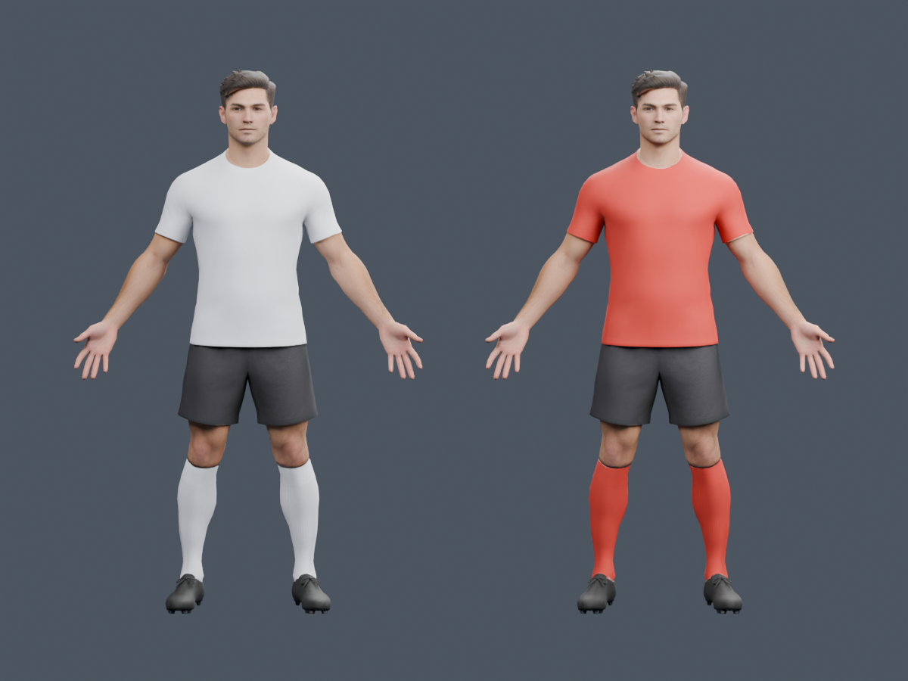

# Run 163 — Tripo asset acquisition and rig QA

1 October 2026. Offline authoring work only. **No app player replacement yet.**

## Added

- Generated one private Smart Mesh P2.0 footballer from our own A-pose reference.
- Exported the textured source and a 52-joint Mixamo auto-rig; both are backed up
  under `Assets/ReplayXI/TripoFootballer`, outside app resources.
- Built white/red 2K kit atlases locally, with identical geometry and scale.
  Inspected front/back renders in Blender. The new kit is blank; the “7” seen
  in the first rear comparison belonged to the old model, not this source.
- Offline near/far topology candidates: 7,954 / 2,134 triangles, from 17,082.
  UVs and four normalized weights survive export/reimport. These numbers do
  not establish runtime frame rate or good animation.
- Added a source-hash / credit-ledger audit and seven regression tests.

## Spend

Starting balance 3,145. One free mesh trial, 20 credits for texture, 20 for rig:
**our spend 40**. Latest observed balance 3,050; an additional 55-credit decrease
was not from our jobs. Shared-account credit history was not inspected.
Maximum permitted spend 2,201; minimum reserve 944. Recheck live balance before
any new job. No purchase, upgrade or subscription.

## Failed checks — not hidden

1. Canonical 80-bone nearest-surface transfer produced torn hands and collapsed
   arms. Arm-chain constraints fixed the worst hand tearing, but sleeve/shoulder
   deformation still failed visual review. v3 is not approved.
2. The auto-rig GLB has 52 joint nodes with missing rest transforms despite
   nonidentity inverse binds. A derived repair restored rest-skin consistency;
   it did not establish correct anatomical pivots or motion.
3. An offline 22-major-joint retarget still showed collapsed arms and sleeve
   gaps. v4 is rejected. Its script is retained only to reproduce the failed
   experiment; finite bounds are not a motion-quality pass.
4. The Blender-specific FBX ZIP export was blocked by Chrome
   (`ERR_BLOCKED_BY_CLIENT`). No download restriction was bypassed. The user
   was asked to provide this export; no further credits are needed for export.

## Verification

- Both downloaded GLB SHA-256 hashes match the ledger and authoring README.
- Source/credit regression suite: **7 passed**.
- Blender 5.2.1: source, team-kit and idle/run candidate renders inspected.
- LOD GLBs reimport with 52 bones, one material/UV layer, <=4 normalized weights.
  REST consistency is checked separately from motion; the input rig remains
  unapproved. Static source-to-near surface p95: 0.60 mm at the source's ~1 m
  scale; source-to-far p95: 4.69 mm. Player-scale and animated review remain.
- Python syntax and Git whitespace checks passed.
- No app code, runtime asset hash, material/contact gate, performance cap,
  saved review, project setting or signing file was changed by this run.

## Next input and remaining work

Receive the **FBX → Blender / Export Skeleton on** ZIP from the same Tripo
player. Verify its actual bone pivots, rest bind and shoulder/hip movement first.
Then retarget locomotion/kicks/head motion, preserve jersey numbering, generate
native contact/LOD data and verify USDZ/RealityKit import and performance.
Do not promote the rejected GLB studies to the app.

## Repro / local evidence

- `python3 Scripts/audit_replayxi_tripo_sources.py`
- `python3 -m unittest discover -s Scripts/tests -p test_replayxi_tripo_source_audit.py -v`
- `Scripts/blender/prepare_tripo_kit_candidate.py`: new derived output only.
- `Scripts/blender/prepare_tripo_lod_candidates.py`: topology/export study only.
- `.codex-derived/replayxi-tripo163/previews/kit-front-v2.png`, `kit-back-v2.png`
- `.codex-derived/replayxi-tripo163/rig-candidate-v3/previews/`
- `.codex-derived/replayxi-tripo163/autorig-retarget-v4/previews/`
- `.codex-derived/replayxi-tripo163/TripoMaterialReview.blend`

GLB source provenance is in the [authoring README](../../Assets/ReplayXI/TripoFootballer/README.md).
No credentials or download signatures are stored in project files.
